# JAgentDesk

**Self-hosted remote control for your coding agents — your dev environment, in your pocket.**

JAgentDesk runs AI coding agents (Claude Code, Codex, GitHub Copilot, OpenCode, Pi, OMP and more) on
your own machine and lets you drive them from anywhere. A lightweight **daemon** runs on your workstation
and manages the agents; the **desktop** app (macOS / Windows / Linux) and the **mobile** app (iOS /
Android) connect straight to it over **Tailscale** or through an **end-to-end encrypted relay**. Your
code stays on your machine. Every device pairs with the daemon first: you compare a six-digit code on
both screens and approve on both.

> **📦 [Download the latest release →](https://github.com/knoobdev/jagentdesk/releases/latest)**

JAgentDesk is an independently developed fork of [Paseo](https://github.com/getpaseo/paseo). It keeps
up with Paseo (this release includes everything up to Paseo 0.17.3) and adds its own pieces: the relay
next to Tailscale, application-level pairing, built-in tools for Docker, Kubernetes, databases, SSH,
Jira, Argo CD, forges and devices, Bots, and connected hosts.

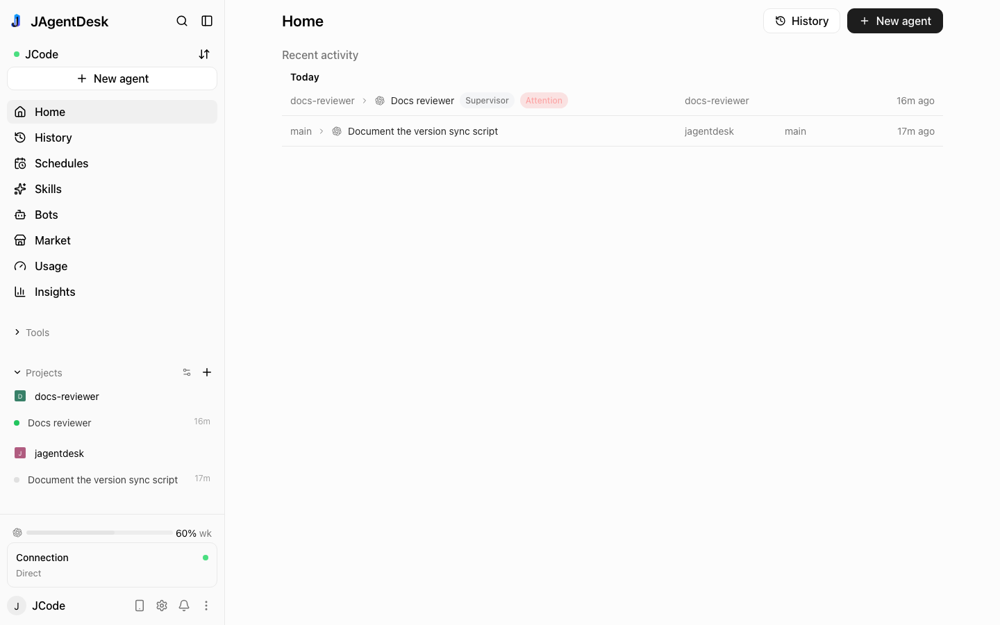

---

## What can it do?

- **Run and steer agents remotely** — start agents, send prompts, watch replies and tool calls stream
  in, interrupt, queue or steer, review diffs, all from desktop or phone.
- **Many providers** — Claude Code, Codex, GitHub Copilot, OpenCode, Pi and OMP, ACP agents, bundled
  provider plugins (Antigravity, Muse Code, Hoplite, fx, goose) and your own OpenAI- or
  Anthropic-compatible model servers. Model, effort and permission controls sit in the composer.
- **Workspaces** — projects, Git worktrees, branches and pull requests; a Changes view with diffs,
  commit and push; files with Preview and an editable Source view; terminals that keep 10,000 rows and
  survive daemon restarts.
- **Bots** — long-lived assistants that plan work, hand it to worker agents in their own worktrees, get
  it cross-reviewed and report back — in the app or in Slack.
- **Connected hosts** — pair daemons with each other so agents can start and message agents on another
  machine.
- **Usage and Insights** — plan limits, reset times and run-out forecasts for every agent account, plus
  token and cost insights.
- **Built-in tools, each a plugin you can switch off per host** — Docker, Kubernetes, Databases, Argo CD,
  SSH servers, Remote tasks, Custom API providers, Jira, Forge Hub, Devices & simulators, Workbench,
  Skills, Spec mode, Autonomous run, Insights, Session sharing and Agentic browser.
- **Orchestration** — Supervisor → Lead → Peer runtime; agents can list, create and message each other.
- **Plugins and Marketplace** — extend the app with screens, sidebar items, panels, composer items,
  timeline rows and themes; install from the Marketplace, a folder, Git or npm. Paseo plugins are
  rebranded on install.
- **Schedules, heartbeats and loops**, voice input, a CLI (`jagentdesk`), and a UI in nine languages.

---

## 🩹 v0.10.1

A fix release: the iOS app opens again, desktop plugins load, and Docker no longer piles up `docker events`
processes. First run is simpler — the desktop connects to its own daemon, and a phone pairs by **Scan QR
code** or **Paste pairing link** through the encrypted relay, with Tailscale optional. Bots can be created
without an identity, have searchable model pickers and explain themselves in the app. Details:
**[docs/releases/v0.10.1.md](docs/releases/v0.10.1.md)**.

## ✨ New in v0.10.0

The full list of changes is in **[docs/releases/v0.10.0.md](docs/releases/v0.10.0.md)**.

### A new app: one sidebar on desktop, a drawer on phones

The Gumloop theme replaces ClickUp. Desktop has one sidebar — host, **New agent**, Home, History,
Schedules, Skills, Bots, Market, Usage, Insights, a **Tools** group and your projects — and a footer with
your plan usage, the connection card and Pair device / Settings / Notifications / More. Opening a
workspace drills the sidebar into Agents, Terminals, Files and Changes. ⌘\ / Ctrl+\ hides it. Gumloop
is the default theme; the other colour themes in Settings → Appearance keep the classic layout.

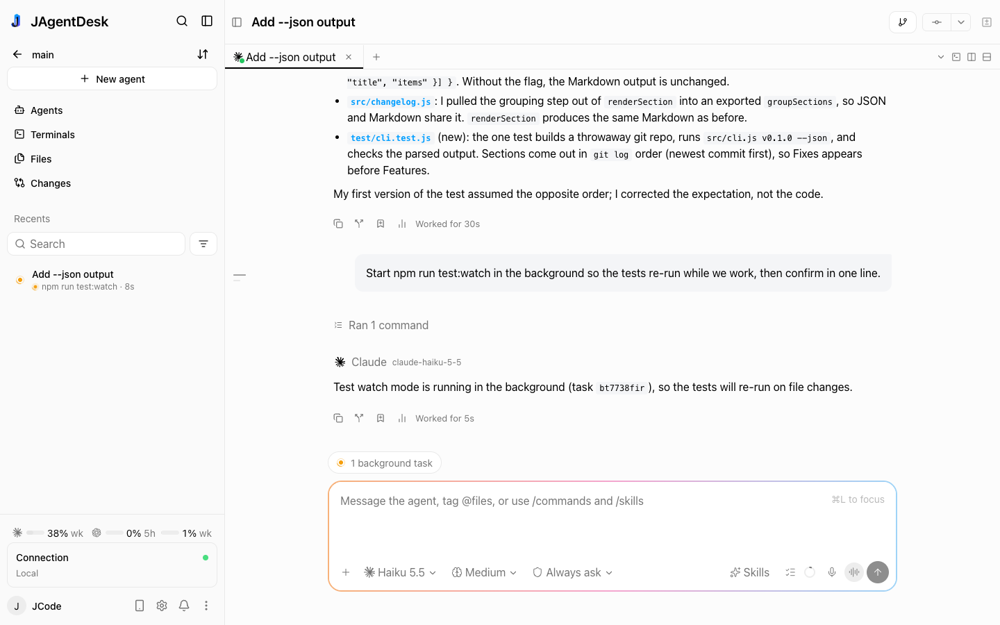

Completed turns fold behind a **"Worked for …"** summary and tool calls group under the reply. The
composer carries the model, effort and permission controls, skills from the `/` menu, and a fullscreen
mode. Changes shows each edit as a selectable diff.

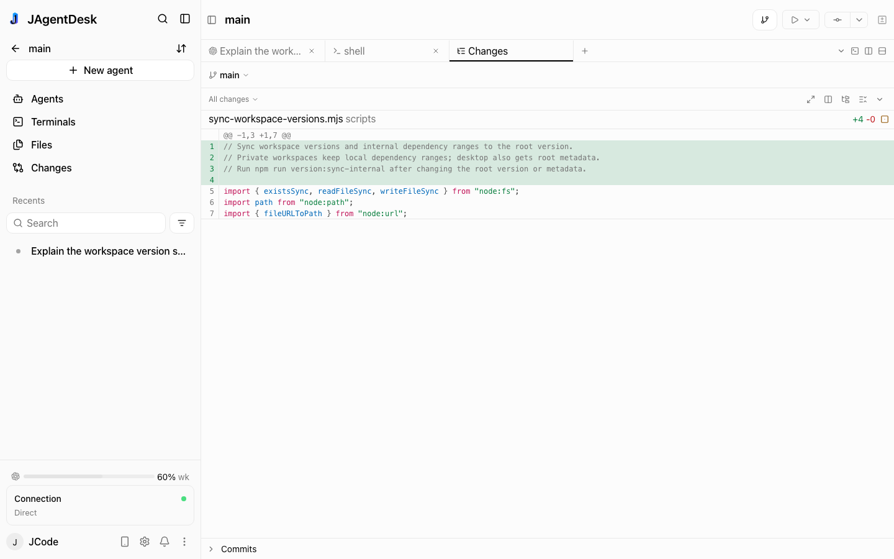

On phones there is no tab bar any more: the sidebar opens as a drawer, panes open as sheets, and
Settings are grouped tiles.

<p>
  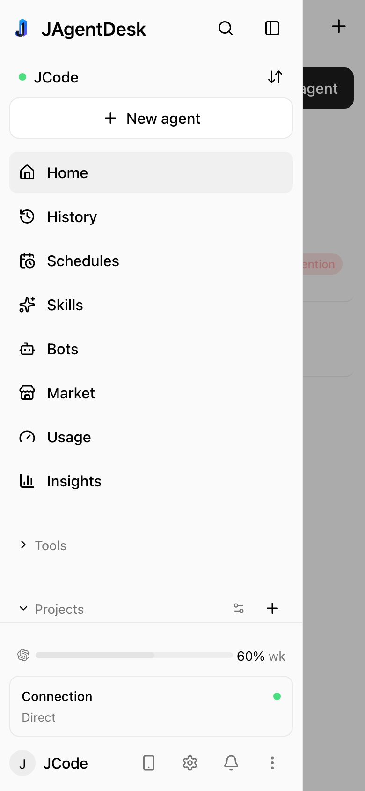
  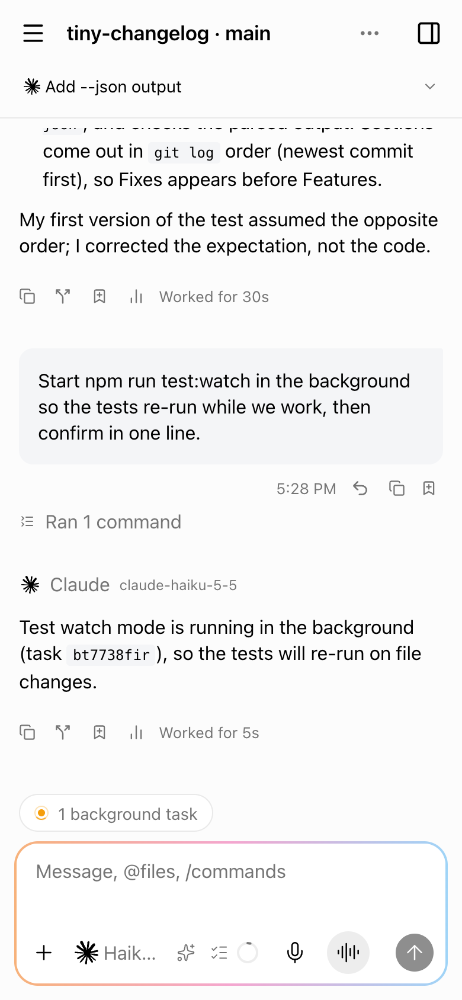
  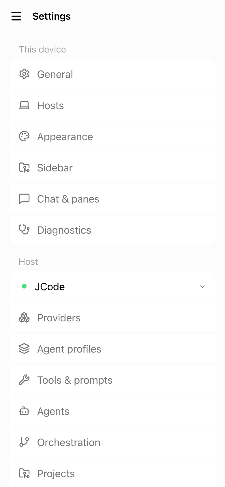
</p>

### Built-in plugins with a switch per host

Seventeen features are now built-in plugins. **Settings → host → Plugins** lists them; turning one off
hides its screens, sidebar entries and agent tools on that host and stops its services, and your data
stays. Autonomous run, Session sharing and Agentic browser are off until you turn them on.

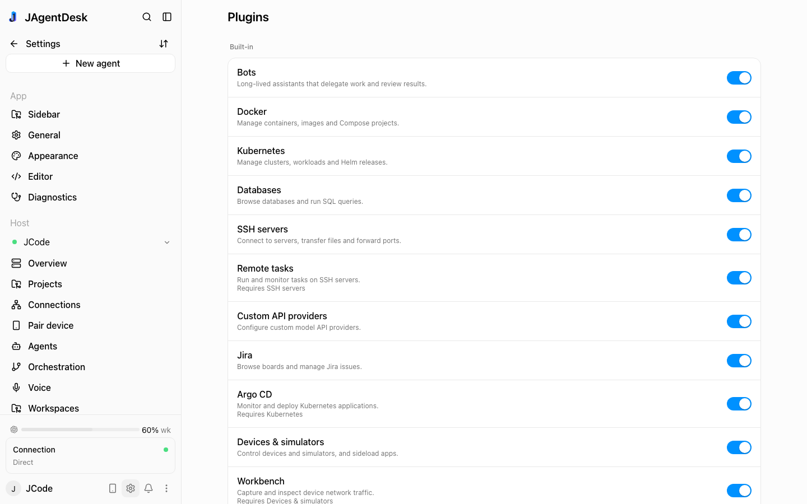

### Bots replace Team mode

A bot has its own identity, chat, items, memory, schedules and settings. It hands real work to worker
agents in their own worktrees, and a BA / Tester / Pentester cross-review checks the result before the bot
reports back. When it needs you, the item asks with quick answers. Bots can also talk in Slack through the
relay.

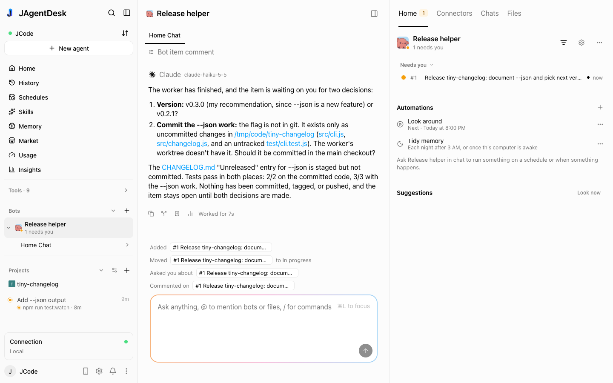

### Encrypted relay alongside Tailscale

The daemon can be reached through an end-to-end encrypted relay as well as the embedded Tailscale
(now 1.106.1). Pairing links carry both routes and the app fails over between them. The relay forwards
encrypted frames only and never holds your keys. Details: [docs/relay.md](docs/relay.md).

### Usage

Every agent account gets a card with its limits, when each resets and when you will run out at the
current pace. Reorder or hide cards, pick the host, and see the same numbers with `jagentdesk usage ls`.

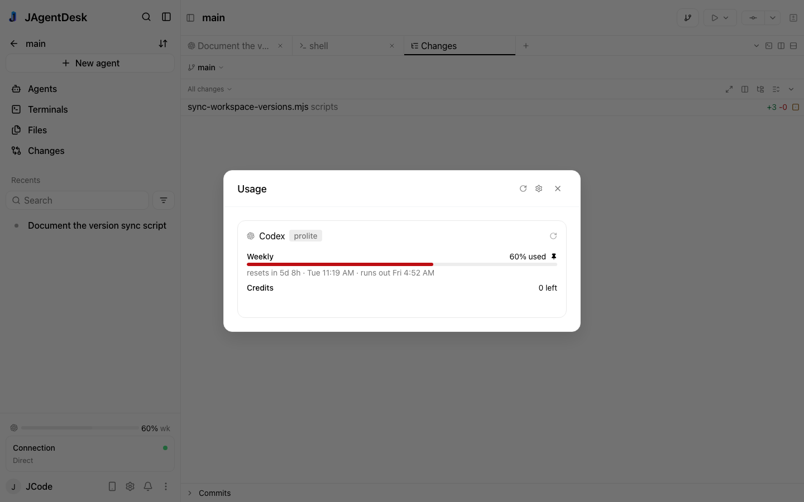

### Connected hosts, lifecycle and terminals

- **Connected hosts:** pair one daemon with another; agents start and message agents on the other host and
  learn when remote children finish, across restarts. See [docs/connected-hosts.md](docs/connected-hosts.md).
- **Agent lifecycle:** an agent idle for an hour releases its process and resumes on your next message;
  agent-to-agent messages queue until the recipient's turn ends; parents are woken after a restart.
- **Terminals:** 10,000 rows replayed with colours on any device, and terminals keep running through
  daemon restarts and updates.

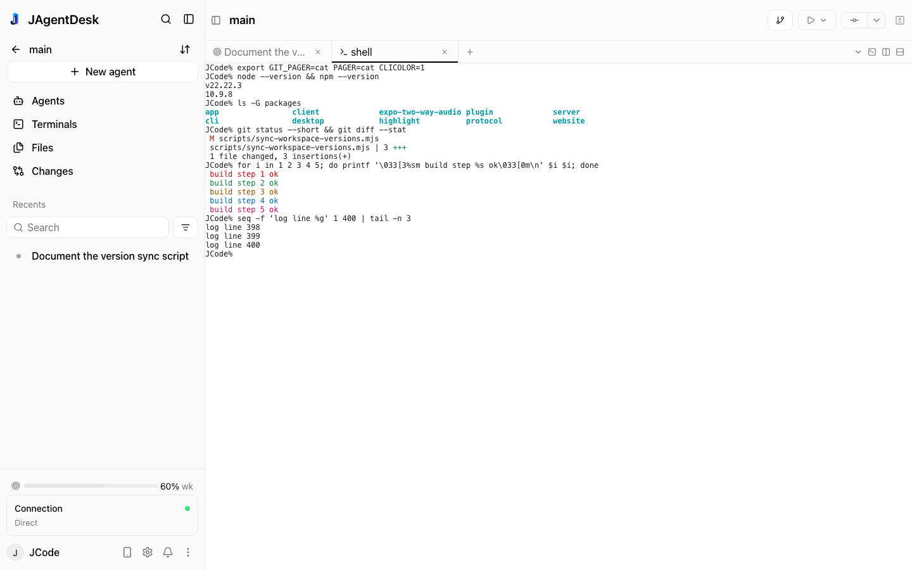

### Before you update

- **Pairing a new device needs a 0.10.0 app.** Devices that are already paired keep working.
- **Team mode, Activity graph, Figma and the ClickUp theme are removed.** Use Bots instead of Team mode;
  ClickUp settings switch to Gumloop automatically.
- **Agent messages queue by default**, and **idle agents release their process after one hour**
  (Settings → host → Agents).

---

## Tools inside the app

Each of these is a built-in plugin with its own entry under **Tools** in the sidebar.

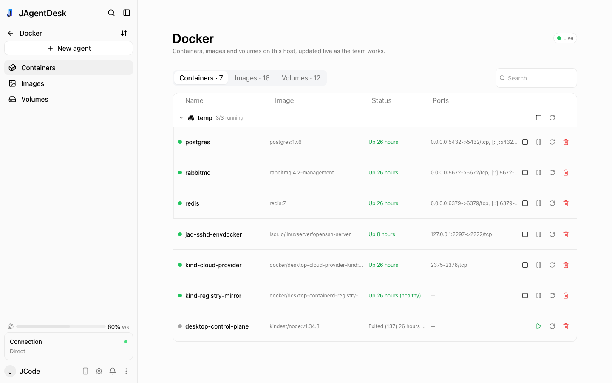

- **Docker** — containers grouped by Compose project, images and volumes, logs, stats, exec and files,
  updated live. [docs/docker.md](docs/docker.md)
- **Kubernetes** — connect any kubeconfig context, browse every resource kind, overview dashboard, logs,
  shell, port-forward, events, scale / restart / rollback / apply, Helm releases, and an **Ask AI** chat
  scoped to the cluster. [docs/kubernetes.md](docs/kubernetes.md)
- **Data** — a database IDE for PostgreSQL, MySQL, SQLite, SQL Server, Oracle, MongoDB and ClickHouse:
  object tree, data grid with inline editing, SQL console with autocomplete and plans, ER diagram and a
  schema-grounded chat. Credentials stay on the daemon. [docs/databases.md](docs/databases.md)
- **Servers (SSH)** — servers, groups and a keychain, terminals that survive closing the app, SFTP, port
  forwarding, jump hosts, snippets, session logs and a chat agent per server. [docs/ssh.md](docs/ssh.md)
- **Remote tasks** — `remote_run` runs a command on another machine (for example a Windows PC through
  WSL2) on a copy of your workspace or with no code at all. [docs/remote-tasks.md](docs/remote-tasks.md)
- **Custom API providers** — point JAgentDesk at an OpenAI- or Anthropic-compatible model server, direct,
  over Tailscale or through an SSH server. [docs/custom-providers.md](docs/custom-providers.md)
- **Jira** — boards, backlog, sprints, issues and a Jira chat agent.
- **Argo CD** — applications with the resource graph, diff, sync, rollback and an Argo CD chat agent.
- **Forge** — GitHub, GitLab and Bitbucket (cloud and self-hosted): repositories, code, pull requests,
  pipelines, releases and issues, plus `forge_*` agent tools. [docs/forge-providers.md](docs/forge-providers.md)
- **Devices** — iOS simulators, Android emulators and real devices with a live screen, plus iOS sideload
  with your Apple ID. [docs/simulators.md](docs/simulators.md)
- **Workbench** — an intercepting proxy for your simulators and devices.
- **Skills** — one hub for SKILL.md skills across providers: browse sources, install for the machine or
  one project, use them from the composer. [docs/skills.md](docs/skills.md)
- **Spec mode** — GitHub Spec Kit's spec-driven workflow, phase by phase, with your approval between
  phases.
- **Autonomous run** _(off by default)_ — keeps the same agent going turn after turn toward a goal, with
  safety caps.
- **Session sharing** _(off by default)_ — share one agent's chat through a web link; guests ask to join
  and enter a code you approve.
- **Agentic browser** _(off by default, desktop)_ — the agent drives a real browser with profiles and a
  session vault. [docs/agentic-browser.md](docs/agentic-browser.md)

---

## Older releases

- **v0.9.59** — Custom API providers (direct, Tailscale or SSH routes; keys stay in the daemon's secret
  store); bypass mode respected for JAgentDesk tools; OpenCode sees JAgentDesk tools from the first
  message; the phone reconnects after the background.
- **v0.9.58** — `remote_run` from any folder, without Git, with only the folders you name or no code.
- **v0.9.57** — Remote tasks: run commands on your PC from chat.
- **v0.9.54** — iPhone touch fix.
- **v0.9.53** — a mobile menu that leaves room for your projects.
- **v0.9.51** — iPhone view-first over the cable; Apple ID sign-in that reaches your teams.
- **v0.9.48** — Jira, Argo CD, iOS sideload, real devices in Sims, Spec mode.
- **v0.9.47** — SSH servers with a chat agent per server.
- **v0.9.43–v0.9.46** — Workbench, the native skills hub, host tools on every OS, agentic browser
  profiles.

Every release is described in [CHANGELOG.md](CHANGELOG.md) and on the
[releases page](https://github.com/knoobdev/jagentdesk/releases).

---

## Quick start

Download a prebuilt app from the **[latest release](https://github.com/knoobdev/jagentdesk/releases/latest)**
(macOS Apple Silicon and Intel, Windows x64 and ARM64, Linux x64, Android APK, iOS IPA). The desktop app
starts its own daemon and connects to it.

To add your phone: on the desktop open **Pair a device**; on the phone tap **Scan QR code** (or **Paste
pairing link**) and confirm the same six-digit code on both screens. The link goes through the encrypted
relay, so no Tailscale account is needed; **Sign in to Tailscale** is there if you want a direct tailnet
connection.

> **macOS:** on Apple Silicon, download the **macOS-Apple-Silicon** asset. Do not install the Intel x64
> asset on Apple Silicon — it would run under Rosetta and the app refuses to start.

To build from source you need **Node.js 22.20.0** and npm (the repo ships a `.tool-versions` file for
[mise](https://mise.jdx.dev/)). Local Android builds need the Android SDK; local iOS builds need Xcode 26.

```bash
git clone https://github.com/knoobdev/jagentdesk.git
cd jagentdesk
npm install
```

Run the daemon, the Expo client and the desktop app in separate terminals:

```bash
npm run dev:server    # the daemon
npm run dev:app       # Expo client (iOS / Android / web)
npm run dev:desktop   # Electron desktop app
```

See [docs/development.md](docs/development.md) for the full setup.

---

## Installing the iOS app (IPA) with Sideloadly

The iOS build ships as an unsigned `.ipa`, so you install it on a real iPhone or iPad signed with your own
Apple ID. **Sideloadly** signs the IPA and installs it over USB.

1. **Install Sideloadly** from `sideloadly.io` (macOS and Windows). On Windows install **iTunes** and
   **iCloud** (the Apple.com versions, not the Microsoft Store ones) first so the device is detected.
2. **Connect your device** over USB, unlock it and tap **Trust** on "Trust This Computer?".
3. **Load the IPA:** drag the JAgentDesk `.ipa` onto the Sideloadly window.
4. **Enter your Apple ID** in the **Apple Account** field. A free Apple ID works for **7 days**; a paid
   **Apple Developer** account signs it for a year.
5. **Click Start.** With two-factor authentication, Sideloadly asks for an **app-specific password** —
   create one at `appleid.apple.com` (Sign-In and Security → App-Specific Passwords). Wait for **"Done"**
   in the log.
6. **Trust the developer on the device:** **Settings → General → VPN & Device Management** (older iOS:
   **Profiles & Device Management**) → your Apple ID under **Developer App** → **Trust**. Then launch
   JAgentDesk.

> The device must be online the first time you trust the certificate. Free Apple IDs allow only a few
> sideloaded apps and expire after 7 days — run Sideloadly again to refresh the signature.

---

## Using the Kubernetes tools

1. **Connect a cluster:** sidebar → **Tools** → **Clusters** → pick a context → **Connect**.
2. **Browse:** press **Open workloads**. Desktop shows kinds, the resource list and the chat side by side;
   on phones the kind menu slides in.
3. **Inspect:** tap a row for overview, YAML, Logs, Shell, Port-forward, Events and actions.
4. **Ask AI:** the agent receives the resource (and open logs) and answers with live `kubectl` output. Add
   a provider and at least one project first so the chat has a working directory.

More in [docs/kubernetes.md](docs/kubernetes.md).

---

## Repository layout

- `packages/server` — the daemon: agent lifecycle, WebSocket API, MCP server, the Tailscale bridge.
- `packages/app` — the Expo client for iOS, Android and web.
- `packages/desktop` — the Electron app for macOS, Windows and Linux.
- `packages/relay` — the end-to-end encrypted relay (Cloudflare Worker and its client).
- `packages/client` and `packages/protocol` — the shared client and the wire protocol.
- `packages/cli` — the `jagentdesk` CLI (`agent`, `daemon`, `host`, `relay`, `usage`, `workspace`, …).
- `plugins/` — built-in plugins (Docker, Kubernetes, Databases, Bots, Usage sources, providers, …).
- `docs/` — architecture, protocol, features and development guides; start at
  [docs/README.md](docs/README.md).

---

## Building releases

`.github/workflows/release.yml` runs on every semver tag (`v*.*.*`) and on manual dispatch. It builds the
desktop apps (macOS / Windows / Linux), an Android APK and an unsigned iOS IPA, and attaches them to the
GitHub release. To cut one:

```bash
# set "version" in the root package.json, then sync every workspace:
npm run version:sync-internal
git tag v0.10.1
git push origin main --tags
```

The native build number follows from the version (`major × 1,000,000 + minor × 1,000 + patch`, so
0.10.0 is 10000). To re-cut only the Android APK, iOS IPA or Apple Silicon build of an existing release,
run the **Release** workflow manually with `tag` set and `only` set to `android`, `ios` or `macos-arm64`.

---

## Contributing

Contributions are welcome — please read [CONTRIBUTING.md](CONTRIBUTING.md) first.

**Contributors**

- **[knoobdev](https://github.com/knoobdev)** — maintainer.
- **Claude** (Anthropic) — feature development & engineering.
- **DeepSeek** — engineering support.

---

## Acknowledgements

Huge thanks to **[Paseo](https://github.com/getpaseo/paseo)** and its contributors — JAgentDesk is forked
from Paseo, and that foundation is what let this project get off the ground so quickly.

## License

JAgentDesk is released under **AGPL-3.0-or-later**. See [LICENSE](LICENSE).
